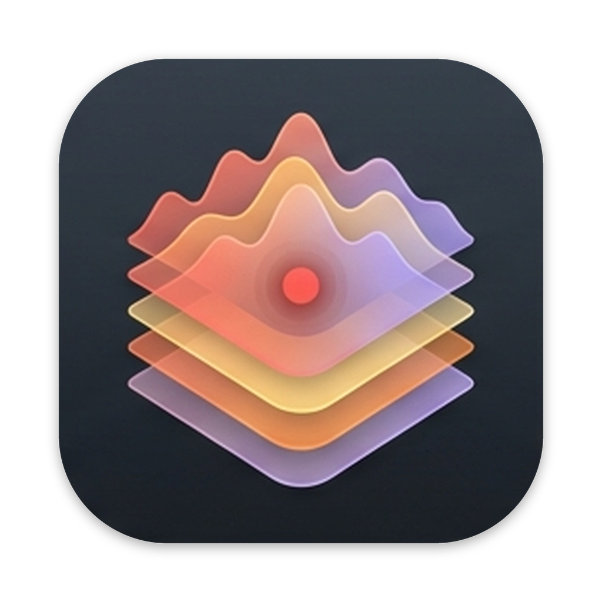

<p align="center">
  
</p>

<h1 align="center">Overdub</h1>

<p align="center">
  Record a song one part at a time over a backing track, with the camera rolling if you want it.
</p>

<p align="center">
  
  
  
  
</p>

---

Overdub is a small macOS recorder for musicians who play along with existing songs. Import a backing track, arm a track, press record, and play your part. Then do it again for the next part. Every pass is kept, so you can go back to an earlier take at any point. If a camera is armed, the video is recorded with the audio and stays in sync through export.

It is not a DAW. It has no tempo, no bars, no MIDI and no sequencer: time is measured in seconds, and everything you hear is either an audio file you imported or something you played.

## Features

**Recording**
- Import backing tracks (WAV, AIFF, CAF, M4A, MP3, FLAC) by menu or drag and drop, converted to the Song's sample rate.
- Record on several armed tracks at once. Each **Pass** produces one dry **Take** per armed track; effects are never baked in.
- Pre-roll, input metering with clip indicators, and monitoring through each track's effects.
- Latency calibration with a loopback cable or a clap, so takes line up with what you heard.

**Editing**
- A non-destructive timeline: move, trim, split and delete clips, with per-clip gain and fades.
- **Take Lanes** under each track show every take recorded there. Click one to swap in an earlier take, or bring a covered take back.
- Pinch to zoom, drag to reorder tracks, and a pastel colour per track.
- Every change is saved as you go, and the full history persists with the Song.

**Mixing and effects**
- A mixer with volume, pan, mute and solo per track, plus a Master.
- Insert Chains of Audio Unit effects (AUv2 and AUv3) on each track and on the Master, with automatic delay compensation.
- Plugins run out of process: if one crashes, its slot is bypassed and the app keeps playing.

**Video**
- Camera capture on the audio clock, so a **Video Take** stays aligned with its pass.
- A synced video preview window and a camera lane on the timeline.

**Separation**
- Split a backing track into six new ones (vocals, drums, bass, guitar, piano, other) with the BS-RoFormer SW model, running locally in a helper process.

**Export**
- Mix down to WAV or M4A.
- Export MP4 video with the mix, either trimmed to the takes or as the full Song.

See [`GLOSSARY.md`](GLOSSARY.md) for what Song, Track, Pass, Take, Clip and the other terms mean precisely.

## Requirements

- macOS on an Intel Mac. v1 builds `x86_64` only; the code is kept arm64-clean.
- Apple clang with C++23 (the Command Line Tools are enough), CMake 3.25+ and Ninja.
- Docker Desktop, only if you want to install the Separation model.

## Getting started

```sh
git clone --recursive https://github.com/mbarbieri/overdub.git
cd overdub
make app        # builds and signs dist/Overdub.app
make install    # copies it to /Applications
```

Overdub signs the app with a stable local identity so camera and microphone permissions survive rebuilds. Create it once in Keychain Access (see [Code signing](docs/building.md#code-signing)).

### Separation model (optional)

The model's weights have no licence grant, so neither the app nor this repo contains them. Each user converts them on their own Mac:

```sh
make separation-model
```

This needs Docker Desktop running. It downloads a pinned checkpoint, checks its SHA-256, exports it to ONNX in a Linux container and installs it in `~/Library/Application Support/Overdub/models/`. Without the model, **Separate…** explains how to install it.

## Development

```sh
git submodule update --init --recursive
cmake --preset debug && cmake --build --preset debug && ctest --preset debug
```

Always use the presets. `make test` runs the same build and the full suite.

The test suite is headless: it drives the engine through `Engine::process(...)` with fake buffers and asserts computed expectations from synthetic signals (impulses, sines, null tests), with no golden files and no audio hardware.

| Path | What lives there |
| --- | --- |
| `src/engine/` | Headless audio engine: transport, render graph, mixer, delay compensation |
| `src/song/` | Song model, on-disk package, history, import |
| `src/capture/` | Recording passes, camera capture, latency calibration |
| `src/plugin/` | Out-of-process Audio Unit hosting |
| `src/video/` | Video preview and placement |
| `src/export/` | WAV, M4A and MP4 export |
| `src/separation/` | The `overdub-separate` helper (ONNX Runtime) |
| `src/ui/`, `src/app/` | JUCE UI and the app shell |
| `src/core/` | Logging, errors, realtime event ring |
| `tests/` | Catch2 tests, mirroring `src/` |

More reading:
- [`docs/building.md`](docs/building.md): build, layout, logs, the JUCE patch and signing.
- [`docs/adr/`](docs/adr/): the architecture decisions, from the stack choice to Separation.
- [`CLAUDE.md`](CLAUDE.md): conventions for the AI agents that write this code.

Overdub's code is written by AI agents (Claude Code) working from GitHub issues, with decisions recorded as ADRs.

## License

Overdub's own source code is released under the [MIT License](LICENSE).

It builds on third-party software with its own licences, in particular [JUCE](https://juce.com/get-juce/) (AGPLv3 or a commercial JUCE licence), [ONNX Runtime](https://github.com/microsoft/onnxruntime) (MIT), [pocketfft](https://github.com/mreineck/pocketfft) (BSD-3-Clause), [nlohmann/json](https://github.com/nlohmann/json) (MIT) and [Catch2](https://github.com/catchorg/Catch2) (BSL-1.0). A built `Overdub.app` includes JUCE, so distributing it is subject to JUCE's terms. The Separation model is not part of Overdub and is not covered by this licence.
